<!-- Images in assets/ are generated. Edit PROFILE in build_assets.py, then run: python build_assets.py -->


  &nbsp;
  &nbsp;
  

 

<picture>
  <source media="(prefers-color-scheme: dark)" srcset="./assets/section-about-dark.svg">
  
</picture>


  

<picture>
  <source media="(prefers-color-scheme: dark)" srcset="./assets/section-selected-work-dark.svg">
  
</picture>

<a href="https://github.com/dhruvsarohaa/MediRoutine"></a>

  <!-- TODO: point this at the AutomateCLI repo once it's public -->
  <a href="https://github.com/dhruvsarohaa"></a>
  
  

 

<picture>
  <source media="(prefers-color-scheme: dark)" srcset="./assets/section-toolkit-dark.svg">
  
</picture>


<!-- Icon names: https://skillicons.dev -->

  

 

<picture>
  <source media="(prefers-color-scheme: dark)" srcset="./assets/section-activity-dark.svg">
  
</picture>

<!-- stats, languages and contributions are refreshed daily by .github/workflows/refresh-assets.yml -->

  
  

 

